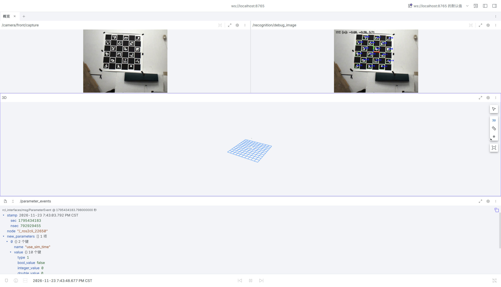
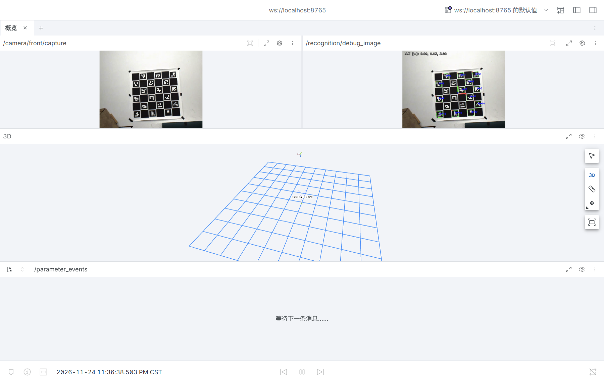

# Foxglove 三维可视化说明（附加项）

这份文档说明怎么把识别节点接到 Foxglove 桌面端，同时看原始图像、带标注的调试图和板中心位姿。
所有命令都在 WSL Ubuntu 22.04 里执行，Foxglove 桌面端装在 Windows 侧。

## 1. 为什么需要 foxglove_bridge

Foxglove 桌面端不能直接读 ROS 2 话题，必须经由 `foxglove_bridge` 把话题转成 WebSocket：

```
WSL (Ubuntu 22.04)                                    Windows
┌──────────────────────────────┐              ┌─────────────────────┐
│ board_recognition_node       │              │  Foxglove 桌面端     │
│   → /recognition/debug_image │              │                     │
│   → /recognition/board_pose  │──┐           │  打开连接            │
│ camera_source_node           │  │           │   → Foxglove WebSocket
│   → /camera/front/capture    │  │           │   → ws://localhost:8765
│ foxglove_bridge  :8765  ◄────┼──┘           │                     │
└──────────────────────────────┘  WebSocket ──►│  图像面板 / 3D 面板  │
```

由此得到三点：

1. GUI 装 Windows，桥装在 WSL，两边必须在同一个 `ROS_DOMAIN_ID` 里。
2. 必须有 `foxglove_bridge` 进程在跑，它是唯一出口。
3. WSL2 会把 WSL 内监听的端口映射到 Windows 的 `localhost`，所以 Windows 侧直接填
   `ws://localhost:8765`，不需要查 WSL 的 IP。

## 2. 环境

```bash
# WSL 侧：ROS 2 Humble + 桥
ls /opt/ros                      # 看到 humble
dpkg -l | grep -i foxglove       # 看到 ros-humble-foxglove-bridge
# 没有就装：sudo apt install ros-humble-foxglove-bridge
```

Windows 侧安装 Foxglove 桌面端（本机路径为 `%LOCALAPPDATA%\Programs\desktop\Foxglove.exe`）。

## 3. 启动

三个终端，顺序不能乱。

```bash
# 终端 1：先编译并 source（桥和节点都要 source 同一个工作空间）
cd <仓库根目录>
source /opt/ros/humble/setup.bash
colcon build
source install/setup.bash
```

```bash
# 终端 2：起桥
source /opt/ros/humble/setup.bash
source install/setup.bash
ros2 run foxglove_bridge foxglove_bridge --ros-args -p port:=8765
```

```bash
# 终端 3：起识别流水线
source /opt/ros/humble/setup.bash
source install/setup.bash
ros2 launch board_recognition recognition.launch.py source:=video \
  video_path:=$(pwd)/media/board_demo_720p_15fps.avi \
  camera_info_url:=file://$(pwd)/config/DA3113952_half.yaml loop:=true
```

桥起来以后，先从 Windows 侧确认端口通：

```powershell
curl.exe -i --max-time 5 -H "Connection: Upgrade" -H "Upgrade: websocket" `
  -H "Sec-WebSocket-Version: 13" -H "Sec-WebSocket-Key: dGhlIHNhbXBsZSBub25jZQ==" `
  http://127.0.0.1:8765/
# 返回 400 "Missing expected sec-websocket-protocol header" 说明桥活着；
# 连接超时或被拒绝则说明桥没起或端口不通。
```

## 4. Foxglove 里的连接与面板

1. 左侧「控制台」→「打开连接」→ 选 **Foxglove WebSocket**（不是「远程访问」）
2. URL 填 `ws://localhost:8765` → 打开
3. 按需添加面板：

| 面板 | 设置 |
| --- | --- |
| 图像 | `/camera/front/capture`，原始画面 |
| 图像 | `/recognition/debug_image`，带标记框、坐标轴和 XYZ 叠加 |
| 3D | 固定参考系 `world`，勾选 `/recognition/board_pose` |
| 原始消息 | `/recognition/board_pose`，看 position / quaternion 数值 |

布局会存成该连接的默认值，下次打开自动恢复。

## 5. 3D 面板需要有 TF

Foxglove 的 3D 面板要靠 TF 树把 `header.frame_id` 解析到固定参考系，而本工程不发布 TF，
所以位姿箭头不会自己出现（网格属于固定参考系本身，仍然能画）。补一条静态变换即可：

```bash
ros2 run tf2_ros static_transform_publisher --x 0 --y 0 --z 0 --roll 0 --pitch 0 --yaw 0 \
  --frame-id world --child-frame-id camera_frame
```

注意两点：已经打开的 3D 面板不会自动出现新话题，要新加一个 3D 面板或重连；
位姿表达的是相机光学系（X 右、Y 下、Z 前），而 Foxglove 的 3D 视图用 X 前、Y 左、Z 上，
所以 z ≈ 3.5 m 会表现为「往上 3.5 m」，需要拉远视角才看得到箭头，这不是解算错误。

## 6. 带宽：为什么仓库里有一份 720p 的回放副本

原始素材是 1440 × 1080 @ 98.95 fps：

```
1440 × 1080 × 3 B ≈ 4.67 MB/帧
4.67 MB × 98.95 ≈ 462 MB/s（仅原始图像一路）
加上 debug_image 后 ≈ 555 MB/s
```

Foxglove 默认 250 MB 的实时帧缓冲不到一秒就满，界面会报「缓冲区已达上限」并开始丢消息。
治标的办法是在数据源面板调大缓冲，治本是降低数据量。仓库里的做法是保留原始素材不动，
另做一份 720 × 540 @ 15 fps 的副本，并配一套同比例缩小的内参：

```bash
ffmpeg -i Video_20261122192405053.avi -vf scale=720:540 -r 15 -c:v mjpeg -q:v 3 \
  media/board_demo_720p_15fps.avi
```

`config/DA3113952_half.yaml` 就是把 `config/DA3113952.yaml` 的 `fx / fy / cx / cy` 和投影矩阵
乘 0.5 得到的结果（畸变系数无量纲，不用改）。降完约 26 MB/s，丢帧和卡顿消失，
位姿数值与全分辨率一致（内参和分辨率是配套的）。

## 7. 常见问题

| 现象 | 原因 / 处理 |
| --- | --- |
| Foxglove 连不上 | 先用上面的 `curl` 握手测试；再 `pgrep -af foxglove_bridge` 看桥是否活着 |
| 连上了但主题列表为空 | 节点没在跑，或两端 `ROS_DOMAIN_ID` 不一致 |
| 图像面板黑屏 | 话题选错（应选 `/recognition/debug_image` 或 `/camera/front/capture`） |
| 自定义消息显示「未知类型」 | 桥没有 source 工作空间，见下一条 |
| `Failed to load schemaDefinition ... package 'interfaces' not found` | 桥的终端漏了 `source install/setup.bash`，桥的环境必须和发布节点一致 |
| 3D 只有网格没有位姿 | 没有 TF，见第 5 节 |
| 画面卡顿、报 250 MB 缓冲 | 带宽超了，见第 6 节 |
| `[video_camera] does not match DA3113952` | `camera_info_url` 里的 `camera_name` 与节点名不一致，仅告警，可改 YAML 消除 |
| 脚本报 `--x: command not found` | 脚本存成了 CRLF，`sed -i 's/\r$//'` 处理 |

## 8. 运行截图



上图自上而下是原始图像、调试图（标记框、板坐标系箭头、板中心 XYZ）和 3D 面板中的板面网格。


