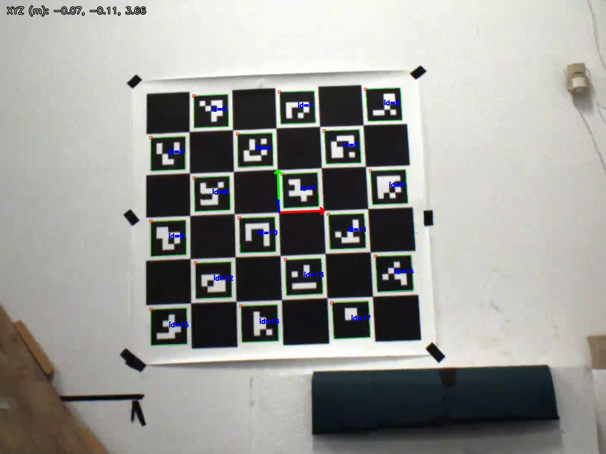
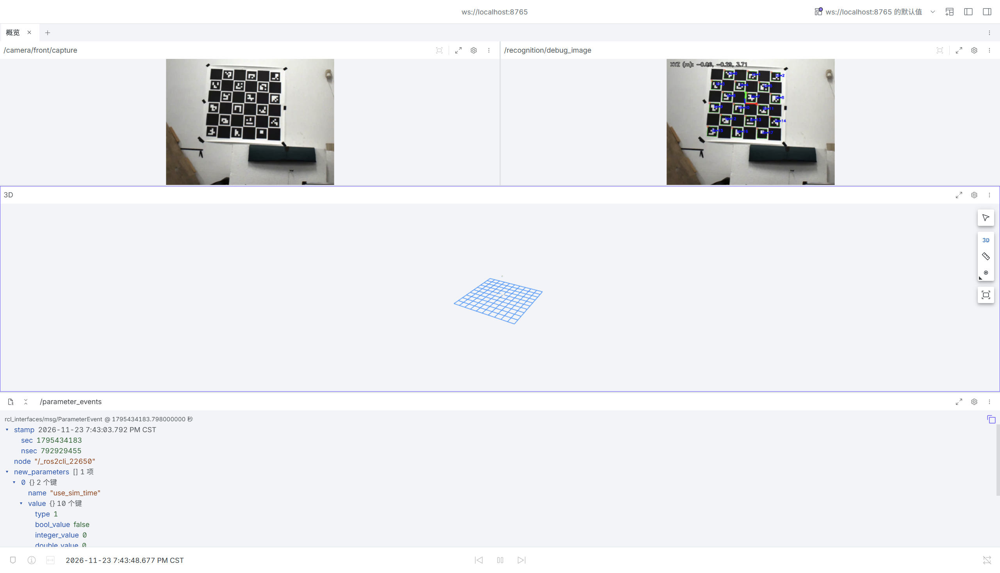

# ChArUco 板识别与位姿解算

视觉组校内赛作业报告。识别节点使用 C++、ROS 2 Humble 与 OpenCV 4.5.4：订阅相机图像与内参，
检测 ChArUco 板，发布板中心相对相机光学坐标系 `camera_frame` 的位姿，并输出带标注的调试图。
离线回放与现场相机共用同一个识别节点。

## 1. 完成情况

| 作业要求 | 落实 |
| --- | --- |
| 订阅图像与内参，识别 ChArUco 板 | `src/board_recognition/src/recognition_node.cpp` |
| 计算板中心相对相机的位置和朝向 | `src/board_recognition/src/board_detector.cpp`（IPPE + LM） |
| 调试图标出标记 ID、边框、XYZ 轴箭头与板中心 XYZ（米） | `drawDetectedMarkers` + `draw_axes` + `add_status_text` |
| 位姿以板中心为原点，输出到 `camera_frame` | 平面点先平移到板中心，输出即 `camera_frame` 光学系 |
| 失败或离开画面时保留上次位姿并显示 `STALE` 与秒数 | 节点内缓存最近有效 `PoseStamped`，用图像时间戳算年龄 |
| `source:=video` / `source:=live` 两种模式共用识别代码 | `src/board_recognition/launch/recognition.launch.py` |
| 发布 `/recognition/board_pose` 与 `/recognition/debug_image` | 见第 7 节话题表 |
| 可选附加项 | Foxglove 三维可视化，见第 9 节 |

## 2. 目录结构

```
src/board_recognition/        识别节点、板模型与 launch
src/camera_frame/             视频回放 / 相机源节点及 launch
src/interfaces/               BoardObservation 消息定义
config/board.yaml             板参数（字典、格数、尺寸、ID）
config/DA3113952.yaml         海康相机 DA3113952 标定（1440 × 1080）
config/DA3113952_half.yaml    720 × 540 回放副本的配套标定
media/                        回放副本、调试图示例与 Foxglove 截图
FOXGLOVE_GUIDE.md             Foxglove 可视化的搭建与排错说明
```

## 3. 实现

### 3.1 标记检测与内角点

对输入图像检测 `DICT_4X4_50` 标记，在调试图上绘制边框和 ID。位姿估计只使用 `config/board.yaml`
里配置的板内 ID（实物板 6 × 6 格，方格边长 0.15 m，标记边长 0.12 m，ID 为 0–17）。

使用最近收到的、与图像尺寸和 frame 一致的 `CameraInfo` 内参与畸变系数：只接受全幅针孔模型，
拒绝 binning、ROI 裁切与非法参数，支持 `plumb_bob`（5 个系数）和 `rational_polynomial`（8 个）。

取到至少 4 个 ChArUco 内角点时优先用内角点做观测；内角点不足时退化为使用板内标记的四角，
此时至少需要 2 个标记。没有可用标定时仍检测并发布调试图，只是不解算位姿。

实物板与 OpenCV 4.5.4 默认棋盘的行交错方向相反（实物板最上行 ID 0、1、2 位于从左数第 2、4、6 格，
第二行从第 1 格起交错），因此 `config/board.yaml` 用 `legacy_pattern: 0` 适配这块板：
节点会把 `objPoints` 按行平移一格并重建 `nearestMarkerIdx` / `nearestMarkerCorners`，
否则内角点插值和位姿都会算错。换成 OpenCV 默认棋盘时设为 `1`。

### 3.2 位姿解算

1. 把平面三维点平移到以板中心为原点的坐标系。
2. 用 `solvePnPGeneric` + `SOLVEPNP_IPPE` 求平面 PnP 的两个候选解。
3. 用 `solvePnPRefineLM` 对每个候选做 LM 细化，剔除包含非有限值、`tz <= 0` 或存在点落在相机后方的解。
4. 投影算 RMS 重投影误差，取误差最小且不超过 3 px 的解；同时用点集凸包面积拒绝退化配置
   （小于格长平方的 1% 视为退化）。
5. 有效位姿沿用对应图像的时间戳，旋转以单位四元数发布。

### 3.3 状态、时间戳与调试图

- 每个收到的图像发布一条 `BoardObservation`，只有解算成功的帧才发布 `/recognition/board_pose`。
- 解算失败时记录最近一次成功位姿及其**原始时间戳**，调试图显示 `STALE`、位姿年龄和上次有效 XYZ。
- 图像超过 `input_timeout_sec`（默认 0.5 s）未到达时，状态额外置 `input_stale=true`，
  同时清空短暂漏检缓存，避免用过期位姿继续补画。
- 短暂漏检时，若本帧仍解出有效板位姿，最近 120 ms 内识别过且完整落在画面内的标记会按本帧位姿
  补画绿色边框并以 `~ID` 标注；`tag_ids` 始终只包含本帧实际读出的 ID。
- 调试图编码为 `bgr8`，订阅与发布都用 Sensor Data QoS；`show_window:=true` 时另开 OpenCV 窗口，
  关闭窗口不影响话题继续输出。无 `DISPLAY` 时自动退回只发话题。

回放视频中的一帧调试图：



绿色框为标记边框，旁边的 `Id=n` 是标记 ID；板中心的红、绿、蓝箭头分别是板坐标系 X、Y、Z 轴
（Z 轴朝向观察者，投影到画面上很短）；左上角是板中心在 `camera_frame` 中的 XYZ，单位为米。

### 3.4 参数

| 参数 | 默认值 | 说明 |
| --- | --- | --- |
| `board_config` | `board_recognition/share/.../config/board.yaml` | 板配置路径 |
| `show_window` | `false` | 是否开 OpenCV 预览窗口 |
| `input_timeout_sec` | `0.5` | 判定输入超时的秒数 |
| `source` | `video` | `video` 回放 / `live` 现场 |
| `video_path` | 空 | 回放视频路径 |
| `camera_info_url` | 配套 DA3113952 标定 | 回放用的标定文件 |
| `loop` | `true` | 回放是否循环 |

## 4. 坐标系

原点位于板中心。以 ID 0–2 在上方、标记正面朝向观察者为准：红色 +X 沿板面向右，绿色 +Y 沿板面向上，
蓝色 +Z 垂直板面朝向观察者，板坐标系为右手系。

输出位姿表示**板坐标系到 `camera_frame` 光学坐标系的变换**。相机 +X 向右、+Y 向下、+Z 向前，
调试图上的 XYZ 数值就是板中心在相机坐标系中的位置，单位为米。

## 5. 编译

在 WSL Ubuntu 22.04 的仓库根目录执行。依赖 ROS 2 Humble、colcon，以及带 aruco 模块的 OpenCV 4.5.4
（Humble 自带的 `libopencv-dev` 即可，不需要额外装 opencv_contrib）。

```bash
source /opt/ros/humble/setup.bash
rosdep install --from-paths src --ignore-src --rosdistro humble -r -y
colcon build
source install/setup.bash
```

## 6. 运行

### 6.1 视频回放

```bash
ros2 launch board_recognition recognition.launch.py source:=video \
  video_path:="/绝对路径/Video_20261122192405053.avi" \
  loop:=false
```

launch 默认加载配套的 DA3113952 标定。换机器时只改 `video_path`；换相机素材时通过
`camera_info_url:=file:///绝对路径/标定.yaml` 指定对应标定。

仓库内附一份 720 × 540 @ 15 fps 的回放副本，配合缩小一半的内参使用：

```bash
ros2 launch board_recognition recognition.launch.py source:=video \
  video_path:=$(pwd)/media/board_demo_720p_15fps.avi \
  camera_info_url:=file://$(pwd)/config/DA3113952_half.yaml loop:=true
```

也可以只用回放节点单独验证图像与标定：

```bash
ros2 launch camera_frame source.launch.py source:=video \
  video_path:="/绝对路径/Video_20261122192405053.avi" \
  camera_info_url:=file://$(pwd)/config/DA3113952.yaml
```

### 6.2 现场相机

```bash
ros2 launch board_recognition recognition.launch.py source:=live
```

live 模式直接订阅车端相机话题，标定从 `/camera/front/camera_info` 读取，因此要求相机节点
同时发布图像与对应的 `CameraInfo`。

## 7. 话题接口

| 方向 | 话题 | 消息 |
| --- | --- | --- |
| 订阅 | `/camera/front/capture` | `sensor_msgs/msg/Image` |
| 订阅 | `/camera/front/camera_info` | `sensor_msgs/msg/CameraInfo` |
| 发布 | `/recognition/board_pose` | `geometry_msgs/msg/PoseStamped` |
| 发布 | `/recognition/debug_image` | `sensor_msgs/msg/Image`（`bgr8`） |
| 发布 | `/recognition/board_observation` | `interfaces/msg/BoardObservation` |

图像订阅与调试图发布使用 Sensor Data QoS，位姿与状态发布使用默认可靠 QoS。
`BoardObservation` 字段：`tag_ids`、`pose_valid`、`has_last_pose`、`last_pose`、`last_pose_stamp`、
`pose_age_sec`、`input_stale`。

## 8. 测试结果

环境：WSL Ubuntu 22.04、ROS 2 Humble、OpenCV 4.5.4；`camera_frame`、`interfaces`、
`board_recognition` 三个包均编译通过。

### 8.1 三张静态图

用发放的 DA3113952 标定跑 C++ 识别节点，逐张发布图像与 `CameraInfo`：

| 图片 | 检出标记数 | 板中心 XYZ（m） |
| --- | ---: | --- |
| `Image_20261122192618491.bmp` | 16 | (-0.143, -0.066, 3.517) |
| `Image_20261122192626869.bmp` | 12 | (0.091, 0.014, 3.472) |
| `Image_20261122192652741.bmp` | 10 | (-0.016, 0.196, 4.611) |

三张图分别覆盖倾斜、正面和仅部分板可见（只有 10 个标记）的情况，均在 3 px 重投影门限内解出位姿。

### 8.2 整段视频

对 `Video_20261122192405053.avi`（1440 × 1080，98.95 fps，1,944 帧）逐帧离线处理：
1,944 帧均检出标记，1,918 帧通过位姿质量检查（98.66%），有效帧的 Z 范围为 3.572–3.725 m。
该比例反映的是解算通过率，位姿的绝对误差需要带真值的测量才能给出。

### 8.3 实时链路

`source:=video` 模式下以源文件约 98.95 fps 回放，订阅端在一次运行中收到 642 条逐帧识别状态、
630 条有效位姿和 602 张 `bgr8` 调试图，回放结束后收到 `input_stale=true` 的状态。
实时链路的接收数受 Sensor Data QoS、队列深度和处理速率影响，逐帧算法统计以离线结果为准。

### 8.4 live 模式

用独立的话题发布器模拟相机：重复发送三张 BMP 并插入黑帧。确认缺标定时仍能检出 ID，
黑帧时不发布新位姿且保留上次位姿的原始时间戳，重新见板后恢复发布，停止输入后报告超时。
海康实机和现场验收留待实机验证。

## 9. 附加项：Foxglove 三维可视化

调试图、原始图像和板位姿可以同时在 Foxglove 桌面端查看，3D 面板里能看到板面网格与位姿坐标系，
方便现场演示和排错。搭建步骤、面板配置、带宽处理和排错表见 [FOXGLOVE_GUIDE.md](FOXGLOVE_GUIDE.md)。



## 10. 已知限制

- 只处理单个板；同画面出现多块板时按同一板模型统一解算，未做多板分离。
- 位姿是板坐标系到相机的变换，不发布 TF，3D 面板需要外部补一条静态变换（见 Foxglove 说明第 5 节）。
- 内角点插值依赖 OpenCV 4.5.4 的 ChArUco 实现；迁移到 OpenCV 4.7 及以上需要改用新版
  `CharucoBoard` API（构造函数与 `objPoints` 的访问方式都变了）。
- 低照度或强反光下标记检测会丢帧，此时节点退化为保留上次位姿并显示 `STALE`，不会输出错误位姿。

## 11. 分支与提交

作业在 `develop` 分支上按功能分次提交，完成后合并到 `main`：

| 提交 | 内容 |
| --- | --- |
| Implement centered ChArUco board pose estimation | 板模型、内角点插值、IPPE + LM 解算 |
| Match the supplied board layout and handle partial views | 实物板行交错适配、部分可见时的退化观测 |
| Publish recognition topics and add replay and live launch | 话题发布、超时状态、video/live 两种 launch |
| Limit OpenCV worker contention during camera replay | 限制 OpenCV 线程数，避免与解码和 ROS 争抢 |
| Document implementation, launch commands and test results | 实现说明与测试记录 |
| Stabilize brief marker gaps and update local media path | 短暂漏检的补画与 `~ID` 标注 |
| Add Foxglove visualization guide and replay assets | Foxglove 附加项与 720p 回放副本 |
